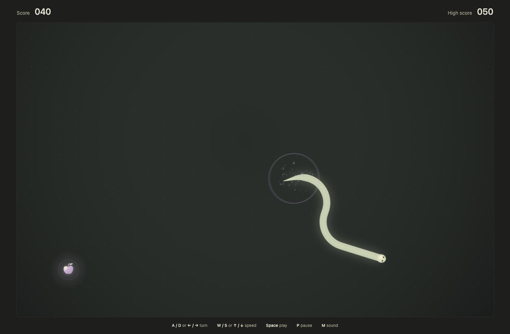

# Radial Snake

A soothing, modern snake game with continuous 360° movement and a body that flows along your path.



## Play locally

Requires Node.js 20+.

```sh
npm install
npm run dev
```

Open the local URL printed in the terminal.

## Controls

| Action | Keys |
| --- | --- |
| Turn left / right | A / D or ← / → |
| Speed up while held | W or ↑ |
| Ease back toward cruising speed | S or ↓ |
| Start / retry / resume | Space |
| Pause / resume | P or Escape (or click the canvas) |
| Toggle sound | M |

Touch devices have on-screen steering and speed controls. Movement is always forward; releasing the speed controls returns you to cruising speed, and you can never slow below it. Edges wrap around.

Eat apples with your head to earn 10 points and grow. Touch your own body and the round ends. Every five apples selects a different soothing palette and increases cruising speed by 4.5%. Your personal best is saved in this browser; passing it earns a particle celebration and optional sound.

Six coordinated palettes color the snake, apples, arena, and interface. Smooth curve ribbons, soft lighting, particles, and ripples keep things a little less grid and a little more flow. Sound is on by default; press M to mute. Reduced-motion preferences are respected.

## Check and build

```sh
npm test        # Gameplay rules: movement, speed, growth, collision, wrapping, reset
npm run build   # TypeScript check and production build in dist/
npm run preview
```

Built with TypeScript, Canvas 2D, and Vite. No game engine or image assets required for gameplay.
